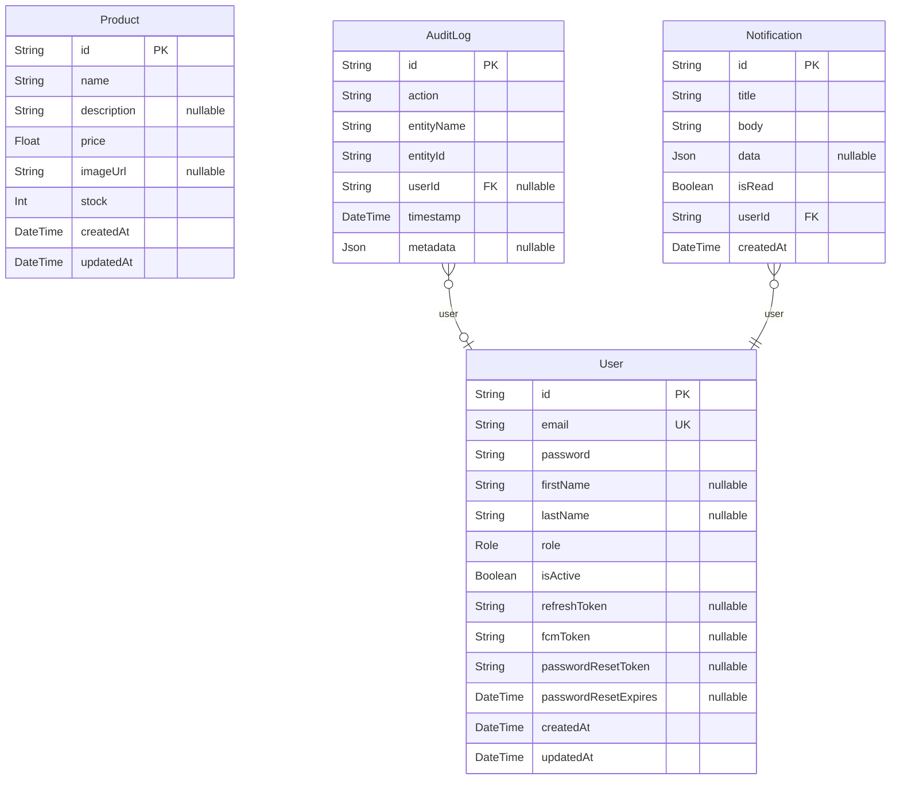

# Database Schema

> Generated by [`prisma-markdown`](https://github.com/samchon/prisma-markdown)

- [default](#default)

## default

### `User`

Properties as follows:

- `id`:
- `email`:
- `password`:
- `firstName`:
- `lastName`:
- `role`:
- `isActive`:
- `refreshToken`:
- `fcmToken`:
- `passwordResetToken`:
- `passwordResetExpires`:
- `createdAt`:
- `updatedAt`:

### `Product`

Properties as follows:

- `id`:
- `name`:
- `description`:
- `price`:
- `imageUrl`:
- `stock`:
- `createdAt`:
- `updatedAt`:

### `AuditLog`

Properties as follows:

- `id`:
- `action`:
- `entityName`:
- `entityId`:
- `userId`:
- `timestamp`:
- `metadata`:

### `Notification`

Properties as follows:

- `id`:
- `title`:
- `body`:
- `data`:
- `isRead`:
- `userId`:
- `createdAt`:
